  

  Sahadaki kâğıdı veriye, veriyi karara çeviriyorum.

  
  
  
  
  

  

---

### 🏭 Hakkımda

- 👷 Üretim
- 🤖 Yapay zekâ projeleri geliştiriyorum
- 📊 Veri analizi ve raporlama ile ilgileniyorum
- 🌱 Şu an yapay zekâ destekli raporlama üzerine çalışıyorum

### 💡 Her Gün Sorduğum Sorular

> *"Bugün hangi makine planın gerisinde kaldı, neden?"*
>
> *"Duruş dakikalarının çoğu hangi iki nedenden geliyor?"*
>
> *"Nasıl bir adım daha ileri gideriz?"*

### 🐍 Katkı Grafiğim

<picture>
  <source media="(prefers-color-scheme: dark)" srcset="https://raw.githubusercontent.com/serotoninim/serotoninim/output/github-snake-dark.svg" />
  <source media="(prefers-color-scheme: light)" srcset="https://raw.githubusercontent.com/serotoninim/serotoninim/output/github-snake.svg" />
  
</picture>

---

  <i>Üretimde yapay zekâ ya da veri üzerine konuşmak ister misin? Bana LinkedIn'den ulaş.</i>

  

