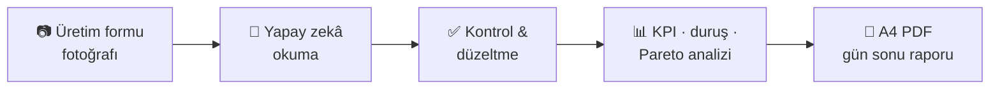

  

  Sahadaki kâğıdı veriye, veriyi karara çeviriyorum.

  
  
  
  
  

---

### 🏭 Hakkımda

- 👷 **Üretim müdürü asistanıyım.** Vardiya, dolum ve makine verileriyle her gün iç içeyim.
- 🤖 **Yapay zekâyı sahada kullanıyorum.** El yazısı üretim formlarını okutup tabloya çeviriyor, gün sonu raporlarını otomatikleştiriyorum.
- 📉 **Kaybın nerede olduğunu buluyorum.** Plan/gerçekleşme, duruş nedenleri ve makine verimi üzerinden.
- 📊 **Temelim veri analizi.** SQL, KPI ve segmentasyonla veriden hikâye çıkarmayı seviyorum.
- 🌱 **Şu an üzerinde çalıştıklarım:** Yapay zekâ destekli raporlama ve üretim verisini ERP (Odoo MRP) ile buluşturmak.

### ⚙️ Fotoğraftan Rapora

### 🧰 Neler Kullanıyorum

| Alan | Araçlar / Teknikler |
|---|---|
| **Üretim** | Plan/gerçekleşme · duruş analizi · makine verimi · adet & litre · Pareto · trend |
| **Yapay Zekâ** | Görüntüden veri okuma · otomatik yönetici özeti · yapay zekâ destekli geliştirme |
| **Veri Analizi** | SQL · CTE (`WITH`) · Window Functions · KPI · LTV · segmentasyon |
| **Raporlama & Geliştirme** | Excel · otomatik PDF raporları · grafikler · JavaScript · Node.js |

### 📌 Öne Çıkan Projeler

| Proje | Açıklama |
|---|---|
| 🏭 **Gün Sonu Üretim Raporu** *(yakında)* | Üretim formunun fotoğrafını yapay zekâyla okuyup KPI'lı, duruş analizli, Pareto grafikli A4 PDF gün sonu raporuna çeviren araç. Geçmiş günlerle ve 7 günlük ortalamayla makine bazında kıyas yapar. |
| 🧠 [**sql-data-analytics-project-advanced**](https://github.com/serotoninim/sql-data-analytics-project-advanced) | CTE, window functions, KPI'lar, zaman içindeki değişim ve segmentasyon üzerine kapsamlı SQL analiz koleksiyonu. |
| 👟 [**Flo_Sql_Query**](https://github.com/serotoninim/Flo_Sql_Query) | Gerçek bir perakende veri setinde müşteri alışverişleri: kanal ve mağaza tipine göre ciro, kategori ilgisi, en değerli müşteriler. |

### 💡 Her Gün Sorduğum Sorular

> *"Bugün hangi makine planın gerisinde kaldı, neden?"*
> *"Duruş dakikalarının çoğu hangi iki nedenden geliyor?"*
> *"Bu hafta litre verimi geçen haftaya göre nerede?"*

### 🐍 Katkı Grafiğim

<picture>
  <source media="(prefers-color-scheme: dark)" srcset="https://raw.githubusercontent.com/serotoninim/serotoninim/output/github-snake-dark.svg" />
  <source media="(prefers-color-scheme: light)" srcset="https://raw.githubusercontent.com/serotoninim/serotoninim/output/github-snake.svg" />
  
</picture>

---

  <i>Üretimde yapay zekâ ya da veri üzerine konuşmak ister misin? Repolarıma göz at ya da bir issue aç.</i>

